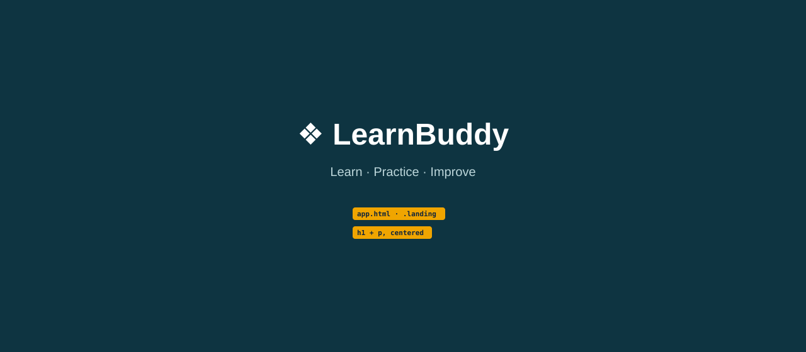

# Topic 01: Angular Application Setup & Architecture, Day 01: Create the App

## What is new today
- A new Angular project named `learnbuddy`, running at `http://localhost:4200/`.
- One component, `App`, that shows a dark teal landing screen with a title and a tagline.
- The first HTML elements (`div`, `h1`, `p`) and the first CSS rules.

## Components

| Component | Owns (what it shows) | Data (exact values) | File |
|---|---|---|---|
| `App` | Full-window dark teal landing screen: title and tagline, centered | Title: `❖ LearnBuddy`. Tagline: `Learn · Practice · Improve`. Background `#0e3441`, title color `white`, tagline color `#bcd6da` | `src/app/app.ts`, `src/app/app.html`, `src/app/app.css` |
| (global) | Page-wide defaults | `margin: 0`, font `Arial, sans-serif` | `src/styles.css` |

## HTML elements used

| Element | What it does on screen |
|---|---|
| `
` | Container for the whole screen. The class `landing` lets CSS style it |
| `<h1>` | The title `❖ LearnBuddy`: large, bold, centered, white |
| `
` | The tagline `Learn · Practice · Improve`: normal size, centered, pale teal |

## CSS used

| Rule | File | What it does on screen |
|---|---|---|
| `body { margin: 0; font-family: Arial, sans-serif; }` | `styles.css` | Removes the white border around the page; sets the font |
| `.landing { background: #0e3441; ... }` | `app.css` | Fills the window with dark teal |
| `.landing` `color: white` | `app.css` | Title text is white |
| `.landing` `min-height: 100vh` | `app.css` | The teal area is at least as tall as the window |
| `.landing` `text-align: center` | `app.css` | Title and tagline are centered |
| `.landing` `padding-top: 120px` | `app.css` | Moves the title 120px down from the top edge |
| `.landing` `box-sizing: border-box` | `app.css` | The 120px padding is counted inside the 100vh height: no scroll bar |
| `.landing p { color: #bcd6da; }` | `app.css` | Tagline is pale teal instead of white |

## Unchanged from yesterday
This is Day 01: everything is new.
