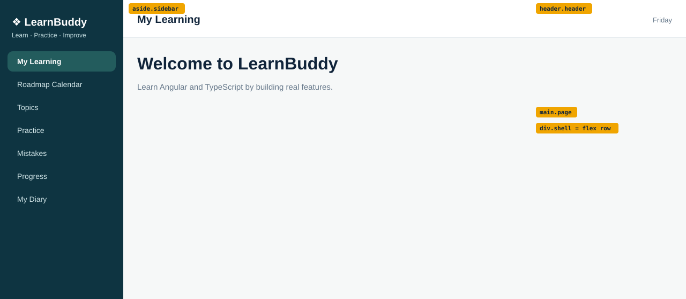

# Topic 01: Angular Application Setup & Architecture, Day 02: Project Tour and App Shell

## What is new today
- The page is now split into a sidebar (left, 230px) and a content area (right) with a header and a page area.
- The sidebar has the brand, the tagline and seven placeholder links; the first is highlighted.
- Layout with flexbox, and the first use of the box model, semantic elements and classes.

## Components
There is still one component, `App`. The three areas below are parts of its template; they become their own components on Day 04 and Day 05.

| Component | Owns (what it shows) | Data (exact values) | File |
|---|---|---|---|
| `App` (sidebar area, `aside.sidebar`) | Dark teal column: brand, tagline, 7 links | Brand `❖ LearnBuddy`; tagline `Learn · Practice · Improve`; links in order: `My Learning` (class `active`), `Roadmap Calendar`, `Topics`, `Practice`, `Mistakes`, `Progress`, `My Diary` | `src/app/app.html`, `src/app/app.css` |
| `App` (header area, `header.header`) | White top bar with a page title on the left and the day on the right | Title `My Learning`; day text `Friday` (typed text today) | `src/app/app.html`, `src/app/app.css` |
| `App` (page area, `main.page`) | Welcome heading and sentence on a light grey background | Heading `Welcome to LearnBuddy`; text `Learn Angular and TypeScript by building real features.` | `src/app/app.html`, `src/app/app.css` |
| (global) | Unchanged | `margin: 0`, font `Arial, sans-serif` | `src/styles.css` |

Colors: sidebar `#0e3441`, brand `white`, tagline `#bcd6da`, link text `#cfe3e6`, active link background `#235c5d`, content background `#f6f8f8`, header line `#dfe6ea`, header day text `#66788a`.

## HTML elements used

| Element | What it does on screen |
|---|---|
| `div.shell` | Outer container that holds the sidebar and the content side by side |
| `aside.sidebar` | The dark left column |
| `div.brand`, `div.tagline` | The brand and tagline lines at the top of the sidebar |
| `nav` | Groups the 7 links |
| `a`, `a.active` | One sidebar row each; `active` marks the highlighted row. No `href`: placeholders |
| `div.content` | The right side (everything except the sidebar) |
| `header.header` | White top bar |
| `h2` | `My Learning` in the header |
| `span` | `Friday` at the right end of the header |
| `main.page` | The page area under the header |
| `h1`, `p` | Welcome heading and sentence |

## CSS used

| Rule | What it does on screen |
|---|---|
| `.shell` `display: flex; min-height: 100vh` | Sidebar and content in a row; the row is at least the window height |
| `.sidebar` `width: 230px; flex: none; box-sizing: border-box` | The sidebar is exactly 230px wide and never shrinks |
| `.sidebar` `background: #0e3441; color: #cfe3e6; padding: 22px 14px` | Dark teal column, pale text, space inside |
| `.brand` | White, 20px, bold; 8px side padding |
| `.tagline` | `#bcd6da`, 12px; padding top 2px, sides 8px, bottom 18px |
| `.sidebar a` | Each link is a block with rounded corners (10px), space inside (11px 14px) and 6px below, text 14px |
| `.sidebar a.active` | Background `#235c5d`, white bold text |
| `.content` `flex: 1; background: #f6f8f8` | Takes all remaining width; light grey |
| `.header` | Flex row: title left, day right, vertically centered; white; 1px line below; padding 16px 26px |
| `.header h2`, `.header span` | Title 20px without margin; day text grey 13px |
| `.page` | Space (24px 26px) around the page content |

## Unchanged from yesterday
`src/styles.css` and `src/app/app.ts` are unchanged. `app.html` and `app.css` are replaced; the Day 01 landing screen is gone.
