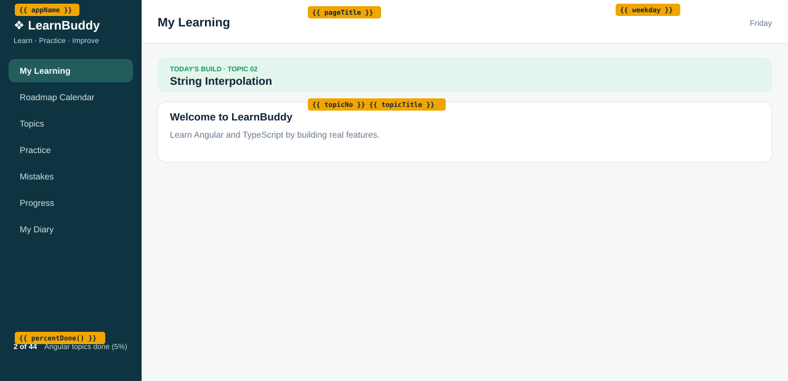

# Topic 02: String Interpolation, Day 03 (Welcome and String Interpolation)

## What is new today
- Every visible text that can change now comes from a property in `app.ts` and is shown with `{{ }}`.
- A sidebar footer shows `2 of 44 Angular topics done (5%)`, calculated by the method `percentDone()`.
- A mint banner shows `TODAY'S BUILD · TOPIC 02` and `String Interpolation`, and the colors move into custom properties in `src/styles.css`.

## Components
Everything is still in one component, `App` (`src/app/app.ts`, class `App`, selector `app-root`). The table splits the screen into the areas you will turn into components on Day 04 and Day 05.

| Component | Owns (what it shows) | Data (exact values) | File |
|---|---|---|---|
| `App` (sidebar area, `<aside class="sidebar">`) | Brand, tagline, 7 placeholder links, footer | `appName` = `'LearnBuddy'`; `tagline` = `'Learn · Practice · Improve'`; links: My Learning (class `active`), Roadmap Calendar, Topics, Practice, Mistakes, Progress, My Diary; `topicsDone` = `2`; `topicsTotal` = `44`; `percentDone()` returns `5`; footer shows `2 of 44 Angular topics done (5%)` | `src/app/app.html`, `src/app/app.ts` |
| `App` (header area, `<header class="header">`) | Page title and weekday | `pageTitle` = `'My Learning'`; `weekday` = today's weekday in full, for example `Friday` | `src/app/app.html`, `src/app/app.ts` |
| `App` (banner, `
`) | Today's topic label | `topicNo` = `'02'`; `topicTitle` = `'String Interpolation'`; shows `TODAY'S BUILD · TOPIC 02` and `String Interpolation` | `src/app/app.html`, `src/app/app.ts` |
| `App` (welcome card, `<section class="card">`) | Welcome heading and sentence | Heading `Welcome to LearnBuddy` (uses `appName`); text `Learn Angular and TypeScript by building real features.` | `src/app/app.html` |

The seven sidebar links are plain `<a>` placeholders. They have no `href` and do nothing when clicked until routing (a later day).

## HTML elements used
| Element | What it does on screen |
|---|---|
| `
` | Outer box that holds the sidebar and the content side by side |
| `<aside class="sidebar">` | The dark left column |
| `
`, `
` | Brand text and tagline at the top of the sidebar |
| `<nav>` and seven `<a>` | The list of links; the first has class `active` |
| `
` | Footer text at the bottom of the sidebar |
| `<strong>` (in the footer) | Makes `2 of 44` bold and white |
| `
` | Right side: header and page |
| `<header class="header">`, `<h2>`, `` | White bar with the title `My Learning` and the weekday |
| `<main class="page">` | Main area with the banner and the card |
| `
`, `<small>`, `<strong>` | Mint banner: small green label, then the bold topic title |
| `<section class="card">`, `<h3>`, `
` | White welcome card with a heading and one sentence |

## CSS used
| Rule | What it does on screen |
|---|---|
| `:root { --side ... --page }` (`styles.css`) | Defines the nine colors once |
| `body` (`styles.css`) | No outer margin; font `'Segoe UI', Arial, sans-serif`; text color `var(--ink)` |
| `.card` (`styles.css`) | White background, 1px `--line` border, 14px rounded corners, 16px padding |
| `.shell` | `display: flex`, `min-height: 100vh`: sidebar and content side by side, full screen height |
| `.sidebar` | Flex column, 230px wide, `flex: none`, background `var(--side)`, padding `22px 14px` |
| `.brand`, `.tagline` | White 20px bold brand; 12px light-teal tagline |
| `.sidebar a`, `.sidebar a.active` | Link rows with rounded corners; the active one has background `var(--side-active)`, white bold text |
| `.side-footer`, `.side-footer strong` | `margin-top: auto` puts it at the bottom; 12px text; `strong` is white |
| `.content` | `flex: 1`, background `var(--page)` |
| `.header`, `.header h2`, `.header span` | White flex bar with a bottom border; title 20px; weekday 13px in `var(--muted)` |
| `.page` | `padding: 24px 26px` |
| `.build`, `.build small`, `.build strong` | Mint rounded banner; label is a block, 11px, bold, green, letter-spaced; title 18px |

**Unchanged from yesterday:** the sidebar link names and order, the layout widths, the dark sidebar color `#0e3441`, `app.ts`'s class name `App`, and `src/index.html`.
