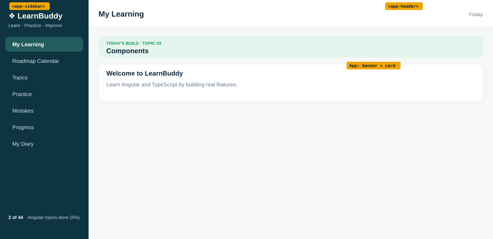

# Topic 03: Components, Day 04 (Sidebar and Header Components)

## What is new today
- The sidebar is its own component `Sidebar` (`<app-sidebar />`) and the header is its own component `Header` (`<app-header />`). Each has its own data and its own CSS file.
- Sidebar links change color when the mouse is over them (`:hover`) with a short `transition`.
- The topic banner now reads `TODAY'S BUILD · TOPIC 03` and `Components`.

## Components
| Component | Owns (what it shows) | Data (exact values) | File |
|---|---|---|---|
| `App` (selector `app-root`) | The layout shell, the topic banner and the welcome card; places `<app-sidebar />` and `<app-header />` | `appName` = `'LearnBuddy'`; `topicNo` = `'03'`; `topicTitle` = `'Components'` | `src/app/app.ts`, `app.html`, `app.css` |
| `Sidebar` (selector `app-sidebar`) | Brand, tagline, 7 placeholder links (first has class `active`), footer `2 of 44 Angular topics done (5%)` | `appName` = `'LearnBuddy'`; `tagline` = `'Learn · Practice · Improve'`; `topicsDone` = `2`; `topicsTotal` = `44`; `percentDone()` returns `5`; links: My Learning, Roadmap Calendar, Topics, Practice, Mistakes, Progress, My Diary | `src/app/sidebar/sidebar.ts`, `sidebar.html`, `sidebar.css` |
| `Header` (selector `app-header`) | Page title and today's weekday | `pageTitle` = `'My Learning'`; `weekday` = today's weekday in full, for example `Friday` | `src/app/header/header.ts`, `header.html`, `header.css` |

The seven sidebar links are plain `<a>` placeholders (no `href`) until routing.

## HTML elements used
| Element | What it does on screen |
|---|---|
| `<app-sidebar />`, `<app-header />` | Place the two components inside `app.html` |
| `
` | Holds sidebar and content side by side |
| `<aside class="sidebar">` (in `sidebar.html`) | The dark left column |
| `<nav>` and seven `<a>` | The navigation links |
| `
`, `<strong>` | Footer text, `2 of 44` in bold |
| `<header class="header">`, `<h2>`, `` (in `header.html`) | White bar with `My Learning` and the weekday |
| `<main class="page">`, `
`, `<small>`, `<strong>` | Page area and the mint banner |
| `<section class="card">`, `<h3>`, `
` | Welcome card |

## CSS used
| Rule | What it does on screen |
|---|---|
| `sidebar.css` `.sidebar` | As Day 03, plus `min-height: 100vh;` so the aside is full window height |
| `sidebar.css` `.brand`, `.tagline`, `.side-footer`, `.side-footer strong` | As Day 03 |
| `sidebar.css` `.sidebar a` | As Day 03, plus `transition: background 0.15s;` |
| `sidebar.css` `.sidebar a.active` | Teal `var(--side-active)` background, white bold text |
| `sidebar.css` `.sidebar a:hover` (new) | Background `var(--side-active)` and white text while the mouse is over the link |
| `header.css` `.header`, `.header h2`, `.header span` | As Day 03 |
| `app.css` `.shell`, `.content`, `.page`, `.build`, `.build small`, `.build strong` | As Day 03 |
| `styles.css` (global) | Unchanged: nine custom properties, `body`, `.card` |

**Unchanged from yesterday:** how the page looks (except the banner text and the hover effect), `src/styles.css`, all texts, colors and sizes, and the sidebar link order.
