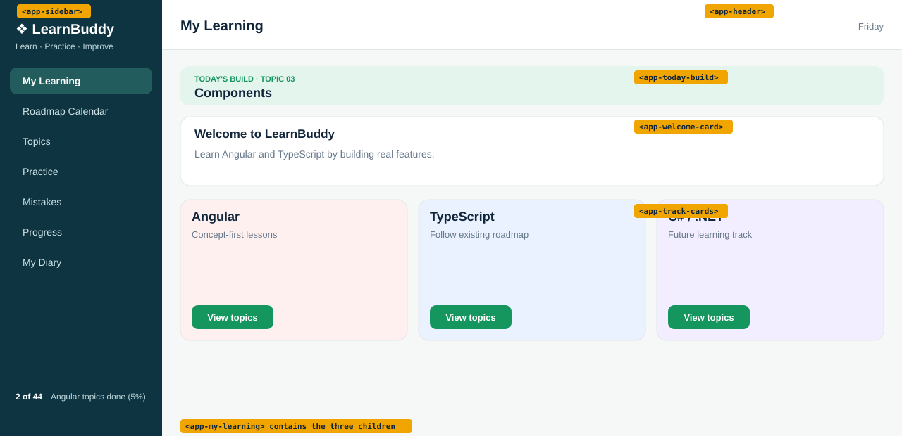

# Topic 03: Components, Day 05: My Learning page (parent and child)

## What is new today
- The main area of the page is now one component, `MyLearning`, that shows three child components: `TodayBuild`, `WelcomeCard`, `TrackCards`.
- `TrackCards` is new: three coloured track cards (Angular, TypeScript, C# / .NET) in a 3-column grid.
- `App` no longer has data or banner CSS. It only shows `Sidebar`, `Header` and `MyLearning`.

## Components

| Component | Owns (what it shows) | Data (exact values) | File |
|---|---|---|---|
| `App` | The shell: sidebar on the left, header and page on the right | none (empty class) | `src/app/app.ts`, `app.html`, `app.css` |
| `Sidebar` | Brand, tagline, 7 links, footer `2 of 44 Angular topics done (5%)` | `appName` `'LearnBuddy'`, `tagline` `'Learn · Practice · Improve'`, `topicsDone` `2`, `topicsTotal` `44` | `src/app/sidebar/sidebar.ts`, `.html`, `.css` |
| `Header` | Title and weekday | `pageTitle` `'My Learning'`, `weekday` = today's weekday name | `src/app/header/header.ts`, `.html`, `.css` |
| `MyLearning` (new) | Shows the three children below, one under the other | none | `src/app/my-learning/my-learning.ts`, `.html`, `.css` |
| `TodayBuild` (new) | Mint banner `TODAY'S BUILD · TOPIC 03` and `Components` | `topicNo` `'03'`, `topicTitle` `'Components'` | `src/app/today-build/today-build.ts`, `.html`, `.css` |
| `WelcomeCard` (new) | White card: `Welcome to LearnBuddy` and one sentence | `appName` `'LearnBuddy'` | `src/app/welcome-card/welcome-card.ts`, `.html`, `.css` (empty) |
| `TrackCards` (new) | Three cards: Angular, TypeScript, C# / .NET, each with a `View topics` button | none (texts are written in the HTML) | `src/app/track-cards/track-cards.ts`, `.html`, `.css` |

The seven sidebar links are, in order: My Learning (has class `active`), Roadmap Calendar, Topics, Practice, Mistakes, Progress, My Diary. They are plain `<a>` placeholders until routing is taught.

## HTML elements used (new today)

| Element | What it does on screen |
|---|---|
| `<app-my-learning />`, `<app-today-build />`, `<app-welcome-card />`, `<app-track-cards />` | Angular replaces each tag with that component's HTML |
| `<section>` | Groups one card (the welcome card; each track card) |
| `<h3>` | Card heading (`Welcome to LearnBuddy`, `Angular`, `TypeScript`, `C# / .NET`) |
| `<button>` | The `View topics` button in each track card |
| `
` | Holds the three track cards; it is the grid |

## CSS used (new today)

| Rule | What it does on screen |
|---|---|
| `app-today-build, app-welcome-card, app-track-cards { display: block; margin-bottom: 16px; }` (`my-learning.css`) | The three children are blocks with 16px of space below each |
| `.tracks { display: grid; grid-template-columns: repeat(3, 1fr); gap: 16px; }` | Three equal columns with 16px between cards |
| `.track` | 1px border (`--line`), rounded corners 14px, 16px padding |
| `.track h3` | No space above the heading, 8px below |
| `.track p` | Muted grey text, 24px of space below |
| `.angular` / `.typescript` / `.csharp` | Card backgrounds `#fff0f0`, `#eaf2ff`, `#f3eeff` |
| `.track button` | Green (`--green`) button, white bold text, no border, rounded 9px, hand cursor |
| `.track button:hover` | Button 10% darker while the mouse is on it |
| `.build`, `.build small`, `.build strong` (now in `today-build.css`) | Same mint banner as Day 4 |
| `.shell`, `.content`, `.page` (`app.css`) | Same layout as Day 4 |

## Unchanged from yesterday
Sidebar and Header (files and look), `src/styles.css` (including global `.card`), the mint banner look, and the welcome card look. Only where the code lives changed.
