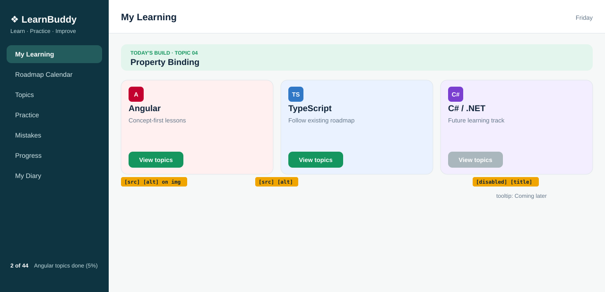

# Topic 04: Property Binding, Day 06: Track cards with icons and a locked button

## What is new today
- Each track card has a 32 by 32 icon (`public/angular.svg`, `public/typescript.svg`, `public/csharp.svg`) set with `[src]` and `[alt]`.
- The track names now come from properties in `track-cards.ts`.
- The C# / .NET button is disabled with `[disabled]="csharpLocked"` and has the tooltip `Coming later` with `[title]="csharpHint"`.
- The banner shows topic `04` `Property Binding`.

## Components

| Component | Owns (what it shows) | Data (exact values) | File |
|---|---|---|---|
| `App` | The shell: sidebar, header, page | none | `src/app/app.ts`, `app.html`, `app.css` |
| `Sidebar` | Brand, tagline, 7 links, footer `2 of 44 Angular topics done (5%)` | `appName` `'LearnBuddy'`, `tagline` `'Learn · Practice · Improve'`, `topicsDone` `2`, `topicsTotal` `44` | `src/app/sidebar/sidebar.ts`, `.html`, `.css` |
| `Header` | Title and weekday | `pageTitle` `'My Learning'`, `weekday` = today's weekday name | `src/app/header/header.ts`, `.html`, `.css` |
| `MyLearning` | The three children, one under the other | none | `src/app/my-learning/my-learning.ts`, `.html`, `.css` |
| `TodayBuild` | Mint banner `TODAY'S BUILD · TOPIC 04` and `Property Binding` | `topicNo` `'04'`, `topicTitle` `'Property Binding'` (changed today) | `src/app/today-build/today-build.ts`, `.html`, `.css` |
| `WelcomeCard` | `Welcome to LearnBuddy` card | `appName` `'LearnBuddy'` | `src/app/welcome-card/welcome-card.ts`, `.html`, `.css` |
| `TrackCards` | Three cards with icon, name, sentence and `View topics` button | `angularName` `'Angular'`, `typescriptName` `'TypeScript'`, `csharpName` `'C# / .NET'`, `angularIcon` `'angular.svg'`, `typescriptIcon` `'typescript.svg'`, `csharpIcon` `'csharp.svg'`, `csharpLocked` `true`, `csharpHint` `'Coming later'` | `src/app/track-cards/track-cards.ts`, `.html`, `.css` |
| Icon files | Red `A`, blue `TS`, purple `C#` squares, 32 by 32 | fill `#C3002F`, `#3178C6`, `#7A3FD0` | `public/angular.svg`, `public/typescript.svg`, `public/csharp.svg` |

The sidebar links are plain `<a>` placeholders until routing is taught.

## HTML elements used (new today)

| Element / attribute | What it does on screen |
|---|---|
| `` | Shows the 32 by 32 icon at the top of each card |
| `<button [disabled]="csharpLocked">` | C# button cannot be clicked and looks dimmed |
| `<button [title]="csharpHint">` | Tooltip `Coming later` on hover |
| `{{ angularName }}` etc. in `<h3>` | Card heading text from the class |

## CSS used (new today)

| Rule | What it does on screen |
|---|---|
| `.track img { display: block; margin-bottom: 8px; }` | Icon on its own line, 8px of space below it |
| `.track button:disabled { background: #aab7bd; cursor: not-allowed; filter: none; }` | Grey C# button, forbidden cursor, no darkening on hover |

## Unchanged from yesterday
Sidebar, Header, `MyLearning`, `WelcomeCard`, the grid (`.tracks`), card colours and green button style, the `.track button:hover` darkening for enabled buttons, `src/styles.css`.
