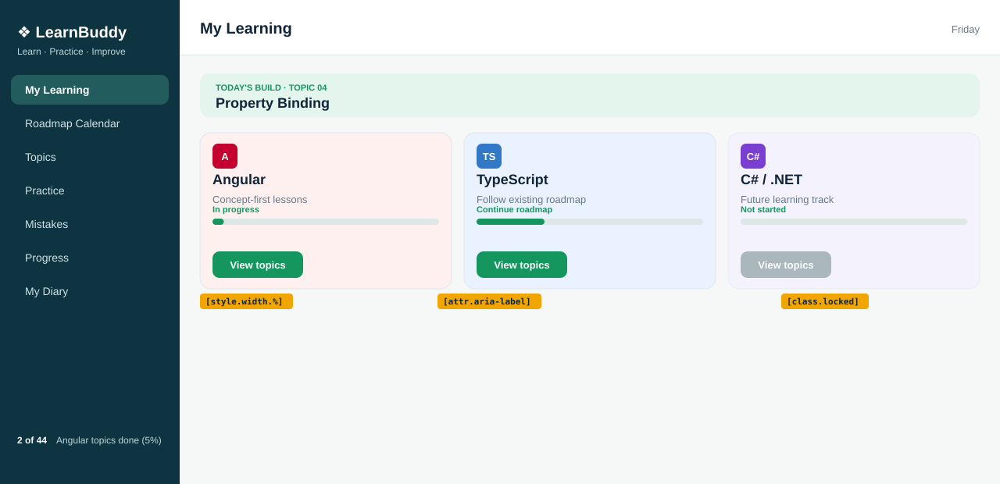

# Topic 04: Property Binding, Day 07: Track card states (class, style, attr)

## What is new today
- Each track card shows a status text and a progress bar. The bar fill width comes from a number in the class (`[style.width.%]`), and the bar has an `aria-label` (`[attr.aria-label]`).
- The C# card gets the state class `locked` (`[class.locked]="csharpLocked"`), so it is faded.
- `.track p` bottom margin changes from 24px to 8px to make room for the status and the bar.

## Components on screen

| Component | Owns (what it shows) | Data (exact values) | File |
|---|---|---|---|
| `App` | Page shell: `<app-sidebar />`, `<app-header />`, `<main class="page">` with `<app-my-learning />` | none | `src/app/app.html` |
| `Sidebar` | Brand, tagline, 7 links (My Learning is active), footer | `appName` 'LearnBuddy'; `tagline` 'Learn · Practice · Improve'; `topicsDone` 2; `topicsTotal` 44; footer shows `2 of 44 Angular topics done (5%)` | `src/app/sidebar/sidebar.html` |
| `Header` | Page title and weekday | `pageTitle` 'My Learning'; `weekday` from today's date | `src/app/header/header.html` |
| `MyLearning` | Holds the three blocks below | none | `src/app/my-learning/my-learning.html` |
| `TodayBuild` | Mint banner `TODAY'S BUILD · TOPIC 04` and `Property Binding` | `topicNo` '04'; `topicTitle` 'Property Binding' | `src/app/today-build/today-build.html` |
| `WelcomeCard` | Card `Welcome to LearnBuddy` | `appName` 'LearnBuddy' | `src/app/welcome-card/welcome-card.html` |
| `TrackCards` (changed today) | Three track cards, each with icon, name, description, status, progress bar, button | see next table | `src/app/track-cards/track-cards.html` |

`TrackCards` data (all `string`/`number`/`boolean` properties in `track-cards.ts`):

| Card | Name | Icon | Description (fixed text) | Status | Percent | Button |
|---|---|---|---|---|---|---|
| Angular | `angularName` 'Angular' | `angular.svg` | Concept-first lessons | `angularStatus` 'In progress' | `angularPercent` 5 | enabled |
| TypeScript | `typescriptName` 'TypeScript' | `typescript.svg` | Follow existing roadmap | `typescriptStatus` 'Continue roadmap' | `typescriptPercent` 30 | enabled |
| C# / .NET | `csharpName` 'C# / .NET' | `csharp.svg` | Future learning track | `csharpStatus` 'Not started' | none (fixed 0) | disabled, tooltip 'Coming later' (`csharpLocked` true, `csharpHint`) |

## HTML elements used (in the track cards)

| Element | What it does on screen |
|---|---|
| `
` | Container of the three cards (grid, 3 columns) |
| `<section class="track ...">` | One card |
| `` | The 32 x 32 track icon (`src`, `alt`, `width`, `height`) |
| `<h3>` | Track name |
| `
` | Description line |
| `` (new) | Small green status text, e.g. `In progress` |
| `
` (new) | The bar track (grey-green box); has `aria-label` |
| `
` (new) | The filled part; width is the percent |
| `<button>` | `View topics` |

## CSS used (track cards)

| Element / rule | What it does on screen |
|---|---|
| `.track p` (changed) | Description text; bottom margin now `8px` |
| `.status` (new) | Inline-block, `margin-bottom: 8px`, 11px, bold, green `#15965f` |
| `.bar` (new) | `height: 8px`, `margin-bottom: 16px`, background `#dde7e5`, `border-radius: 4px`, `overflow: hidden` |
| `.bar-fill` (new) | `height: 100%`, background green `#15965f`; width set inline by Angular |
| `.locked` (new) | `opacity: 0.65`: the whole C# card is faded |
| `.track button:disabled` (Day 6) | Grey `#aab7bd` button, `not-allowed` cursor, `filter: none` |
| `.track img` (Day 6) | `display: block`, `margin-bottom: 8px` |

**Unchanged from yesterday:** `App`, `Sidebar`, `Header`, `MyLearning`, `TodayBuild` (banner stays topic 04), `WelcomeCard`, the `public/` icons, and the existing track card rules.
