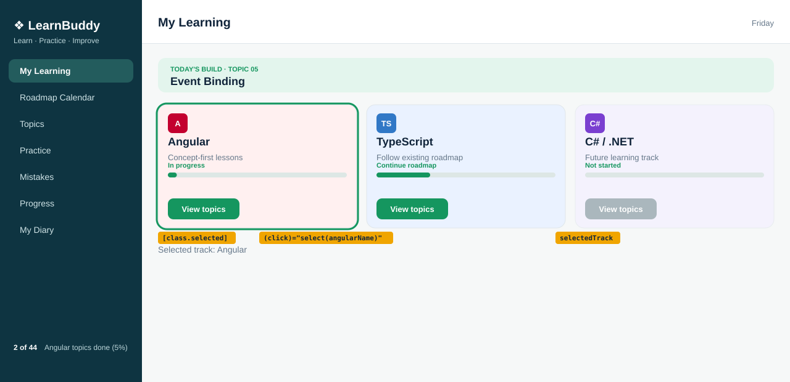

# Topic 05: Event Binding, Day 08: Clickable track cards

## What is new today
- Clicking a `View topics` button selects that track: `(click)="select(angularName)"` stores the name in `selectedTrack`.
- The selected card gets a 3px green outline (`[class.selected]="selectedTrack === angularName"`), and a line below the cards reads `Selected track: Angular`.
- Keyboard focus on the buttons shows a blue ring (`:focus-visible`). The banner now says topic 05.

## Components on screen

| Component | Owns (what it shows) | Data (exact values) | File |
|---|---|---|---|
| `App` | Page shell: `<app-sidebar />`, `<app-header />`, `<main class="page">` with `<app-my-learning />` | none | `src/app/app.html` |
| `Sidebar` | Brand, tagline, 7 links (My Learning is active), footer | `appName` 'LearnBuddy'; `tagline` 'Learn · Practice · Improve'; `topicsDone` 2; `topicsTotal` 44; footer `2 of 44 Angular topics done (5%)` | `src/app/sidebar/sidebar.html` |
| `Header` | Page title and weekday | `pageTitle` 'My Learning'; `weekday` from today's date | `src/app/header/header.html` |
| `MyLearning` | Holds the three blocks below | none | `src/app/my-learning/my-learning.html` |
| `TodayBuild` (changed) | Mint banner `TODAY'S BUILD · TOPIC 05` and `Event Binding` | `topicNo` '05'; `topicTitle` 'Event Binding' | `src/app/today-build/today-build.html` |
| `WelcomeCard` | Card `Welcome to LearnBuddy` | `appName` 'LearnBuddy' | `src/app/welcome-card/welcome-card.html` |
| `TrackCards` (changed) | Three track cards and the selected-track line | see next table | `src/app/track-cards/track-cards.html` |

`TrackCards` data (properties in `track-cards.ts`):

| Card | Name | Status | Percent | Button click runs | Selected at start |
|---|---|---|---|---|---|
| Angular | `angularName` 'Angular' | 'In progress' | 5 | `select(angularName)` | yes |
| TypeScript | `typescriptName` 'TypeScript' | 'Continue roadmap' | 30 | `select(typescriptName)` | no |
| C# / .NET | `csharpName` 'C# / .NET' | 'Not started' | 0 | `select(csharpName)`, but the button is disabled (`csharpLocked` true, tooltip 'Coming later') so it never runs | no |

New: `selectedTrack: string = 'Angular';` and method `select(track: string): void`.

## HTML elements used (new or changed today)

| Element | What it does on screen |
|---|---|
| `<button (click)="...">` | `View topics`; click selects the card; Tab moves focus to it; Enter or Space also clicks |
| `<section class="track ... selected">` | The selected card (class added by Angular) |
| `
` (new) | Text `Selected track: Angular`, below the three cards |

## CSS used (new today)

| Rule | What it does on screen |
|---|---|
| `.selected` | `outline: 3px solid var(--green)`: green line around the selected card, no layout shift |
| `.selected-line` | `margin: 12px 0 0`, color `#66788a` (muted), 14px |
| `.track button:focus-visible` | `outline: 3px solid var(--blue)` and `outline-offset: 2px` on a keyboard-focused button |
| `.locked` (Day 7) | `opacity: 0.65`: faded C# card |
| `.bar`, `.bar-fill`, `.status` (Day 7) | Bars and status texts, unchanged |

**Unchanged from yesterday:** `App`, `Sidebar`, `Header`, `MyLearning`, `WelcomeCard`, the icons, the status texts, the bars, the faded C# card.
