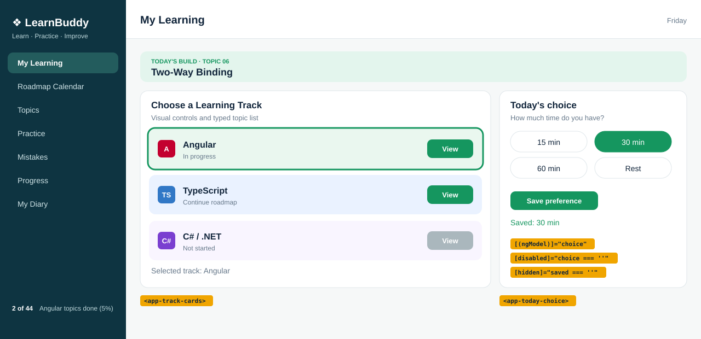

# Topic 06 Two-Way Binding: Day 9 UI breakdown

## What is new today
- `TodayChoice` (new): a "Today's choice" card with four radio chips and a Save button, using `[(ngModel)]`.
- `TrackCards` is now a card with three rows (it was three tall cards). `WelcomeCard` is deleted.
- `MyLearning` shows the track card and the choice card in two columns (`2fr 1fr`).

## Components

| Component | Owns (what it shows) | Data (exact values) | File |
|---|---|---|---|
| `App` | Page shell: sidebar, header, page | none | `src/app/app.html` |
| `Sidebar` | Dark left column, 7 links, footer | `2 of 44 Angular topics done (5%)` | `src/app/sidebar/sidebar.html` |
| `Header` | Title and weekday | `pageTitle` `My Learning`, weekday of today | `src/app/header/header.html` |
| `MyLearning` | Banner, then the two-column area | none | `src/app/my-learning/my-learning.html` |
| `TodayBuild` | Mint banner | `topicNo` `'06'`, `topicTitle` `'Two-Way Binding'` | `src/app/today-build/today-build.ts` |
| `TrackCards` | Card `Choose a Learning Track` with 3 rows | names `Angular`, `TypeScript`, `C# / .NET`; statuses `In progress`, `Continue roadmap`, `Not started`; `selectedTrack` starts as `Angular`; `csharpLocked` `true`; `csharpHint` `Coming later` | `src/app/track-cards/track-cards.html` |
| `TodayChoice` (new) | Card `Today's choice` | `choice` `''`, `saved` `''`; options `15 min`, `30 min`, `60 min`, `Rest` | `src/app/today-choice/today-choice.html` |

`TrackCards` keeps `angularPercent` and `typescriptPercent` in its `.ts` file, but the template no longer uses them.

## HTML elements used (new or changed today)

| Element | What it does on screen |
|---|---|
| `
` | Wraps the two cards so the grid can place them side by side |
| `<section class="card">` | The white card box (global `.card` from `styles.css`) |
| `
` | One colored row in the track card |
| `
` with `<strong>` and `` | Track name (bold, own line) and status text under it |
| `
` | Groups the chips; invisible on screen, read by screen readers |
| `<label class="chip">` | One clickable chip; clicking anywhere on it selects its radio |
| `<input type="radio" name="time" value="15 min">` | The real radio button (hidden by CSS); `name` is `time` on all four |
| `` after the input | The visible chip text (`15 min`, `30 min`, `60 min`, `Rest`) |
| `<button class="save">` | `Save preference`, disabled until a chip is chosen |
| `
` | `Saved: 30 min` line, hidden until saved |

## CSS used (exact values)

`my-learning.css`

| Rule | Declarations | Effect |
|---|---|---|
| `app-today-build` | `display: block; margin-bottom: 16px;` | Banner is a block with space below |
| `.two-col` | `display: grid; grid-template-columns: 2fr 1fr; gap: 16px; align-items: start;` | Two columns, left twice as wide; each card keeps its own height |

`track-cards.css`

| Rule | Declarations | Effect |
|---|---|---|
| `.sub` | `margin: 0 0 12px; color: var(--muted); font-size: 13px;` | Grey small subtitle |
| `.track-row` | `display: flex; align-items: center; gap: 12px; margin-bottom: 10px; padding: 12px 14px; border-radius: 12px;` | Icon, text, button in one row |
| `.angular` / `.typescript` / `.csharp` | `background: #eaf7ef` / `#eaf2ff` / `#f6f0ff` | Row colors |
| `.info` | `flex: 1;` | Text takes the free space, pushes the button right |
| `.info strong` | `display: block; font-size: 16px;` | Name on its own line |
| `.info span` | `color: var(--muted); font-size: 12px;` | Grey status |
| `.track-row button` | `background: var(--green); color: white; border: 0; border-radius: 9px; padding: 8px 18px; font-weight: bold; cursor: pointer;` | Green `View` button |
| `.track-row button:disabled` | `background: #aab7bd; cursor: not-allowed;` | Grey C# button |
| `.track-row button:focus-visible` | `outline: 3px solid var(--blue); outline-offset: 2px;` | Blue ring for keyboard focus |
| `.locked` | `opacity: 0.65;` | Faded C# row |
| `.selected` | `outline: 3px solid var(--green);` | Green ring on the chosen row |
| `.selected-line` | `margin: 12px 0 0; color: var(--muted); font-size: 14px;` | `Selected track: Angular` line |

`today-choice.css`

| Rule | Declarations | Effect |
|---|---|---|
| `.sub` | same as in `track-cards.css` | Grey subtitle |
| `.chips` | `display: grid; grid-template-columns: 1fr 1fr; gap: 8px; margin-bottom: 14px;` | 2 x 2 grid of chips |
| `.chip` | `position: relative;` | Reference point for the hidden input |
| `.chip input` | `position: absolute; opacity: 0;` | Hides the native radio, keeps keyboard access |
| `.chip span` | `display: block; padding: 8px 14px; border: 1px solid var(--line); border-radius: 20px; text-align: center; cursor: pointer;` | The pill shape |
| `.chip input:checked + span` | `background: var(--green); border-color: var(--green); color: white;` | Chosen chip is green |
| `.chip input:focus-visible + span` | `outline: 3px solid var(--blue); outline-offset: 2px;` | Blue ring when reached by Tab |
| `.save` | `background: var(--green); color: white; border: 0; border-radius: 9px; padding: 9px 16px; font-weight: bold; cursor: pointer;` | Green button |
| `.save:disabled` | `background: #aab7bd; cursor: not-allowed;` | Grey button |
| `.saved` | `margin: 12px 0 0; color: var(--green); font-size: 14px;` | Green result line |

**Unchanged from yesterday:** `App`, `Sidebar`, `Header` (files, text, CSS), `track-cards.ts`, `styles.css`.
