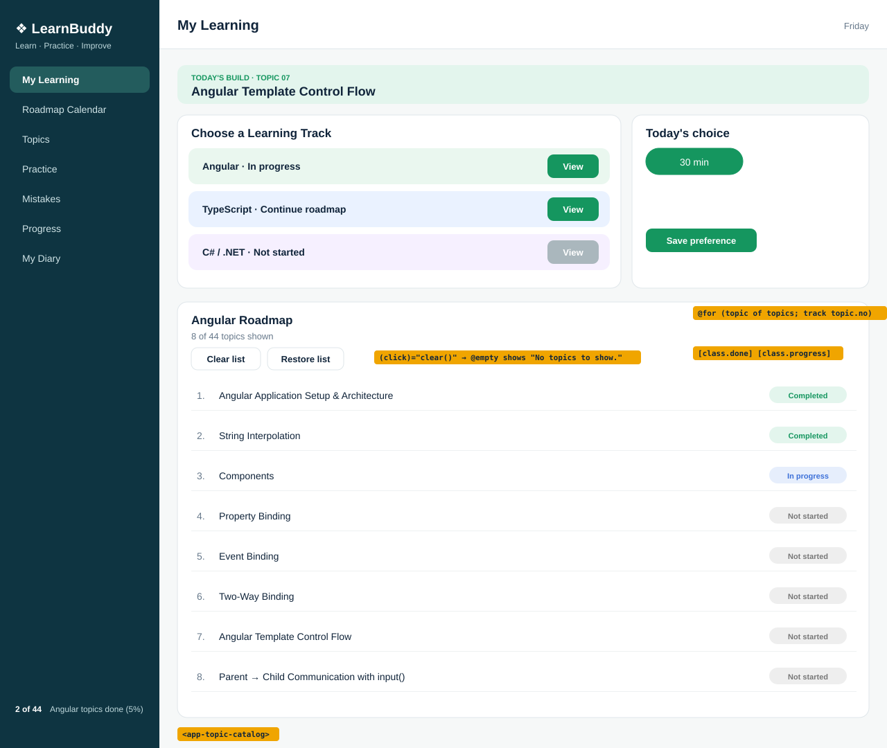

# Topic 07 Angular Template Control Flow: Day 10 UI breakdown

## What is new today
- `TopicCatalog` (new): a card `Angular Roadmap` with 8 topic rows made by `@for`, plus `Clear list` and `Restore list` buttons.
- `MyLearning` now has the catalog below the two columns, and the two columns stack on narrow windows.

## Components

| Component | Owns (what it shows) | Data (exact values) | File |
|---|---|---|---|
| `App` | Page shell | none | `src/app/app.html` |
| `Sidebar` | Left column, 7 links, footer | `2 of 44 Angular topics done (5%)` | `src/app/sidebar/sidebar.html` |
| `Header` | Title and weekday | `My Learning`, weekday of today | `src/app/header/header.html` |
| `MyLearning` | Banner, two columns, catalog | none | `src/app/my-learning/my-learning.html` |
| `TodayBuild` | Mint banner | `topicNo` `'07'`, `topicTitle` `'Angular Template Control Flow'` | `src/app/today-build/today-build.ts` |
| `TrackCards` | Track list card | unchanged from Day 9 | `src/app/track-cards/track-cards.html` |
| `TodayChoice` | Choice card | unchanged from Day 9 | `src/app/today-choice/today-choice.html` |
| `TopicCatalog` (new) | Card `Angular Roadmap` | see table below | `src/app/topic-catalog/topic-catalog.html` |

`TopicCatalog` data (`ANGULAR_TOPICS`; the property `topics` starts as a copy of it):

| no | title | status |
|---|---|---|
| 1 | Angular Application Setup & Architecture | Completed |
| 2 | String Interpolation | Completed |
| 3 | Components | In progress |
| 4 | Property Binding | Not started |
| 5 | Event Binding | Not started |
| 6 | Two-Way Binding | Not started |
| 7 | Angular Template Control Flow | Not started |
| 8 | Parent → Child Communication with input() | Not started |

The subtitle shows `8 of 44 topics shown` (`topics.length` is 8), and `0 of 44 topics shown` after `Clear list`.

## HTML elements used (new today)

| Element | What it does on screen |
|---|---|
| `<h3>` | Card title `Angular Roadmap` |
| `
` | Grey line `8 of 44 topics shown` |
| `
` with two `<button>` | `Clear list` and `Restore list` side by side |
| `<ul class="topic-list">` | The list; its bullets are removed by CSS |
| `<li class="topic-row">` | One topic row (made by `@for`) |
| ``, ``, `` | Number with a dot (`1.`), title, status pill |
| `<li class="empty">` | `No topics to show.` shown by `@empty` when the list is empty |

## CSS used (exact values)

`my-learning.css`

| Rule | Declarations | Effect |
|---|---|---|
| `app-today-build, app-topic-catalog` | `display: block; margin-bottom: 16px;` | Both are blocks with space below |
| `.two-col` | `display: grid; grid-template-columns: 2fr 1fr; gap: 16px; align-items: start; margin-bottom: 16px;` | Two columns, space below them |
| `@media (max-width: 800px) { .two-col }` | `grid-template-columns: 1fr;` | One column on windows 800px wide or narrower |

`topic-catalog.css`

| Rule | Declarations | Effect |
|---|---|---|
| `.sub` | `margin: 0 0 12px; color: var(--muted); font-size: 13px;` | Grey subtitle |
| `.actions` | `display: flex; gap: 8px; margin-bottom: 8px;` | Buttons in a row |
| `.actions button` | `background: white; color: var(--ink); border: 1px solid var(--line); border-radius: 9px; padding: 7px 14px; font-weight: bold; cursor: pointer;` | White outlined buttons |
| `.topic-list` | `list-style: none; margin: 0; padding: 0;` | No bullets, no indent |
| `.topic-row` | `display: flex; align-items: center; gap: 10px; padding: 10px 4px; border-bottom: 1px solid #eef1f2;` | Row layout with a line below |
| `.num` | `width: 26px; color: var(--muted);` | Fixed-width grey number |
| `.title` | `flex: 1;` | Title fills the space |
| `.badge` | `background: #eeeeee; color: #777777; border-radius: 10px; padding: 2px 10px; font-size: 11px; font-weight: bold;` | Grey pill (Not started) |
| `.badge.done` | `background: var(--mint); color: var(--green);` | Green pill (Completed) |
| `.badge.progress` | `background: #e6eefc; color: var(--blue);` | Blue pill (In progress) |
| `.empty` | `padding: 12px 4px; color: var(--muted);` | Grey empty message |

**Unchanged from yesterday:** `App`, `Sidebar`, `Header`, `TrackCards`, `TodayChoice` (files, text, CSS), `styles.css`.
