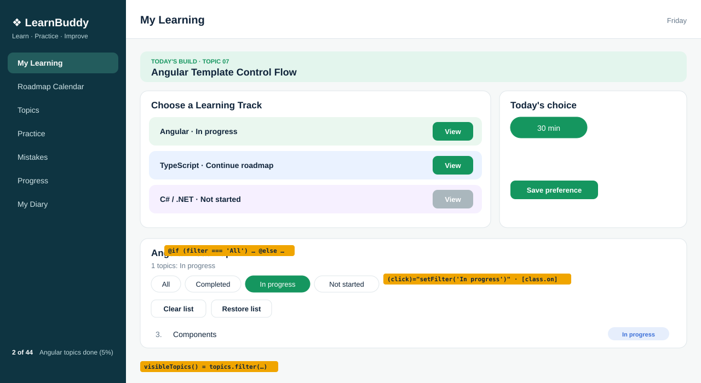

# Topic 07 Angular Template Control Flow: Day 11 UI breakdown

## What is new today
- `TopicCatalog` (changed): four filter chips (`All`, `Completed`, `In progress`, `Not started`) between the subtitle and the `Clear list` / `Restore list` buttons. The chosen chip is green.
- The subtitle now depends on the filter: `8 of 44 topics shown` for `All`, otherwise `N topics: <filter>`.
- The list shows only the topics that match the chosen filter.

## Components

| Component | Owns (what it shows) | Data (exact values) | File |
|---|---|---|---|
| `App` | Page shell | none | `src/app/app.html` |
| `Sidebar` | Left column, 7 links, footer | `2 of 44 Angular topics done (5%)` | `src/app/sidebar/sidebar.html` |
| `Header` | Title and weekday | `My Learning`, weekday of today | `src/app/header/header.html` |
| `MyLearning` | Banner, two columns, catalog | none | `src/app/my-learning/my-learning.html` |
| `TodayBuild` | Mint banner | `topicNo` `'07'`, `topicTitle` `'Angular Template Control Flow'` | `src/app/today-build/today-build.ts` |
| `TrackCards` | Track list card | unchanged | `src/app/track-cards/track-cards.html` |
| `TodayChoice` | Choice card | unchanged | `src/app/today-choice/today-choice.html` |
| `TopicCatalog` (changed) | Card `Angular Roadmap` with chips | see tables below | `src/app/topic-catalog/topic-catalog.html` |

`TopicCatalog` data (`ANGULAR_TOPICS`, unchanged; `topics` starts as a copy of it):

| no | title | status |
|---|---|---|
| 1 | Angular Application Setup & Architecture | Completed |
| 2 | String Interpolation | Completed |
| 3 | Components | In progress |
| 4 | Property Binding | Not started |
| 5 | Event Binding | Not started |
| 6 | Two-Way Binding | Not started |
| 7 | Angular Template Control Flow | Not started |
| 8 | Parent → Child Communication with input() | Not started |

New class members of `TopicCatalog`:

| Member | Value / behavior |
|---|---|
| `filter: string` | Starts as `'All'` |
| `setFilter(value: string): void` | Sets `this.filter = value` |
| `visibleTopics()` | Returns `this.topics` when `filter` is `'All'`, otherwise `this.topics.filter(topic => topic.status === this.filter)` |

What each filter shows (with the full list of 8):

| Chip clicked | `filter` | Rows shown | Subtitle |
|---|---|---|---|
| All | `'All'` | 1 to 8 | `8 of 44 topics shown` |
| Completed | `'Completed'` | 1, 2 | `2 topics: Completed` |
| In progress | `'In progress'` | 3 | `1 topics: In progress` |
| Not started | `'Not started'` | 4, 5, 6, 7, 8 | `5 topics: Not started` |

After `Clear list` with `All`: subtitle `0 of 44 topics shown` and `No topics to show.`. After `Clear list` with another chip, for example `Completed`: subtitle `0 topics: Completed` and `No topics to show.`.

## HTML elements used (new today)

| Element | What it does on screen |
|---|---|
| `
` | Holds the four chips in one row |
| `<button class="chip">` (4) | One filter chip each: `All`, `Completed`, `In progress`, `Not started` |
| `@if` / `@else` with `
` | Shows one of two subtitle lines |

Existing elements (`<section class="card">`, `<h3>`, `
`, `<ul class="topic-list">`, `<li class="topic-row">`, the three `` parts, `<li class="empty">`) are unchanged. The `@for` now loops over `visibleTopics()`.

## CSS used (new today, added to the end of `topic-catalog.css`)

| Rule | Declarations | Effect |
|---|---|---|
| `.chips` | `display: flex; flex-wrap: wrap; gap: 8px; margin-bottom: 12px;` | Chips in a row, wrapping to a new line when narrow, 8px apart |
| `.chip` | `background: white; border: 1px solid var(--line); border-radius: 20px; padding: 6px 14px; font-size: 13px; cursor: pointer;` | White pill with a light border |
| `.chip.on` | `background: var(--green); border-color: var(--green); color: white;` | Chosen chip is green with white text |

**Unchanged from yesterday:** `App`, `Sidebar`, `Header`, `MyLearning` (files, text, CSS), `TodayBuild` (`'07'`, `'Angular Template Control Flow'`), `TrackCards`, `TodayChoice`, `styles.css`, and every other rule in `topic-catalog.css`.
