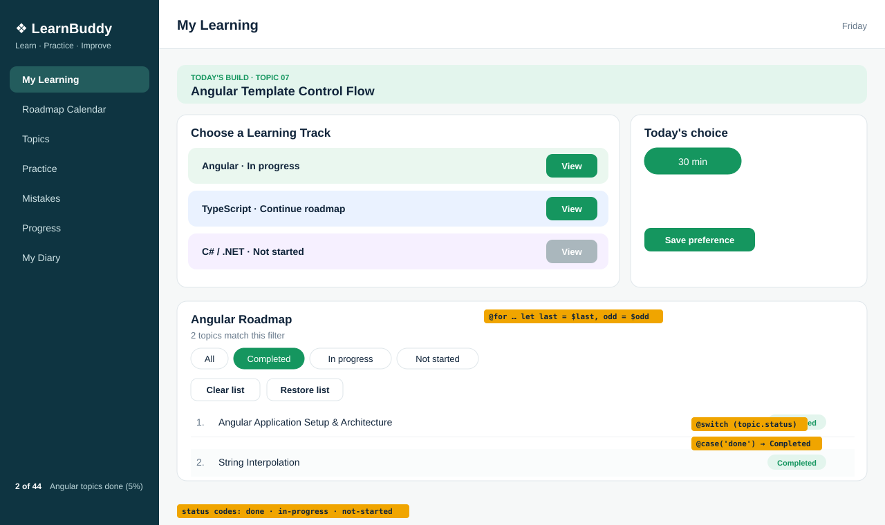

# Topic 07 Angular Template Control Flow: Day 12 UI breakdown

## What is new today
- `TopicCatalog` data and filters use status codes (`'done'`, `'in-progress'`, `'not-started'`; filter `'all'`). The screen text looks almost the same as yesterday.
- Each row's badge is chosen by `@switch` / `@case` / `@default`.
- Rows get classes from loop variables: `odd` (2nd, 4th, 6th, 8th row) gives a faint stripe, `last` removes the line under the final row.

## Components

| Component | Owns (what it shows) | Data (exact values) | File |
|---|---|---|---|
| `App` | Page shell | none | `src/app/app.html` |
| `Sidebar` | Left column, 7 links, footer | `2 of 44 Angular topics done (5%)` | `src/app/sidebar/sidebar.html` |
| `Header` | Title and weekday | `My Learning`, weekday of today | `src/app/header/header.html` |
| `MyLearning` | Banner, two columns, catalog | none | `src/app/my-learning/my-learning.html` |
| `TodayBuild` | Mint banner | `topicNo` `'07'`, `topicTitle` `'Angular Template Control Flow'` | `src/app/today-build/today-build.ts` |
| `TrackCards` | Track list card | unchanged | `src/app/track-cards/track-cards.html` |
| `TodayChoice` | Choice card | unchanged | `src/app/today-choice/today-choice.html` |
| `TopicCatalog` (changed) | Card `Angular Roadmap`, chips, rows | see tables below | `src/app/topic-catalog/topic-catalog.html` |

`TopicCatalog` data (`ANGULAR_TOPICS`; `topics` starts as a copy of it):

| no | title | status (code) | Badge text shown |
|---|---|---|---|
| 1 | Angular Application Setup & Architecture | `'done'` | Completed |
| 2 | String Interpolation | `'done'` | Completed |
| 3 | Components | `'in-progress'` | In progress |
| 4 | Property Binding | `'not-started'` | Not started |
| 5 | Event Binding | `'not-started'` | Not started |
| 6 | Two-Way Binding | `'not-started'` | Not started |
| 7 | Angular Template Control Flow | `'not-started'` | Not started |
| 8 | Parent → Child Communication with input() | `'not-started'` | Not started |

Class members of `TopicCatalog`:

| Member | Value / behavior |
|---|---|
| `filter: string` | Starts as `'all'` |
| `setFilter(value: string): void` | Sets `this.filter = value` |
| `visibleTopics()` | Returns `this.topics` when `filter` is `'all'`, otherwise `this.topics.filter(topic => topic.status === this.filter)` |

Chips (text people read -> code passed to `setFilter`):

| Chip text | Code | Rows shown | Subtitle |
|---|---|---|---|
| All | `'all'` | 1 to 8 | `8 of 44 topics shown` |
| Completed | `'done'` | 1, 2 | `2 topics match this filter` |
| In progress | `'in-progress'` | 3 | `1 topics match this filter` |
| Not started | `'not-started'` | 4, 5, 6, 7, 8 | `5 topics match this filter` |

Row classes with the filter `all` (8 rows): rows 2, 4, 6, 8 have `odd`; row 8 has `last`. With the filter `done` (2 rows): row 2 has `odd` and `last`. With `in-progress` (1 row): that row has `last` only. After `Clear list`: no rows, `No topics to show.`; the subtitle is `0 of 44 topics shown` with `all`, or `0 topics match this filter` with another chip.

## HTML elements used (new today)

| Element | What it does on screen |
|---|---|
| `@switch (topic.status)` with `@case` / `@default` | Chooses one of three `` for each row |
| `Completed` | Green pill |
| `In progress` | Blue pill |
| `Not started` | Grey pill |
| `<li class="topic-row" [class.last]="last" [class.odd]="odd">` | A row that gets `odd` and `last` when they apply |

The chips (`<button class="chip">`), `
` and `<ul class="topic-list">` are unchanged, except for the codes in `[class.on]` and `setFilter(...)`.

## CSS used (new today, added to the end of `topic-catalog.css`)

| Rule | Declarations | Effect |
|---|---|---|
| `.topic-row.odd` | `background: #fafcfc;` | Faint stripe on rows 2, 4, 6, 8 |
| `.topic-row.last` | `border-bottom: 0;` | No line under the final row |

**Unchanged from yesterday:** `App`, `Sidebar`, `Header`, `MyLearning` (files, text, CSS), `TodayBuild`, `TrackCards`, `TodayChoice`, `styles.css`, and every other rule in `topic-catalog.css` (including `.chips`, `.chip`, `.chip.on`, `.badge`, `.badge.done`, `.badge.progress`).
