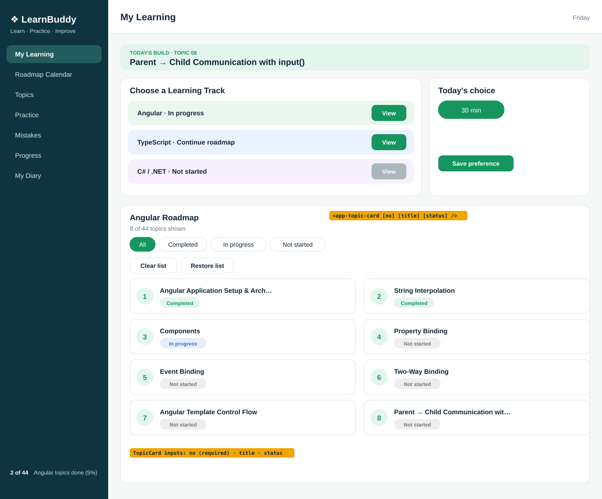

# Topic 08 Parent → Child Communication with input(): Day 13 UI breakdown

## What is new today
- `TopicCard` (new): a reusable card with a round number, a title and a status badge. It has three inputs: `no`, `title`, `status`.
- `TopicCatalog` now shows the 8 topics as cards in a 2-column grid (made by `@for` with `<app-topic-card>`) instead of list rows.
- The badge rules move from `topic-catalog.css` to `topic-card.css`.

## Components

| Component | Owns (what it shows) | Data (exact values) | File |
|---|---|---|---|
| `App` | Page shell | none | `src/app/app.html` |
| `Sidebar` | Left column, 7 links, footer | `2 of 44 Angular topics done (5%)` | `src/app/sidebar/sidebar.html` |
| `Header` | Title and weekday | `My Learning`, weekday of today | `src/app/header/header.html` |
| `MyLearning` | Banner, two columns, catalog | none | `src/app/my-learning/my-learning.html` |
| `TodayBuild` | Mint banner | `topicNo` `'08'`, `topicTitle` `'Parent → Child Communication with input()'` | `src/app/today-build/today-build.ts` |
| `TrackCards` | Track list card | unchanged | `src/app/track-cards/track-cards.html` |
| `TodayChoice` | Choice card | unchanged | `src/app/today-choice/today-choice.html` |
| `TopicCatalog` | Card `Angular Roadmap`, subtitle, filter chips, action buttons, grid of cards | see table below | `src/app/topic-catalog/topic-catalog.html` |
| `TopicCard` (new) | One topic: number circle, title, badge | inputs `no`, `title`, `status` | `src/app/topic-card/topic-card.html` |

`TopicCatalog` data (`ANGULAR_TOPICS` in `topic-catalog.ts`; the property `topics` is a copy of it). The data is unchanged from Day 12:

| no | title | status |
|---|---|---|
| 1 | Angular Application Setup & Architecture | done |
| 2 | String Interpolation | done |
| 3 | Components | in-progress |
| 4 | Property Binding | not-started |
| 5 | Event Binding | not-started |
| 6 | Two-Way Binding | not-started |
| 7 | Angular Template Control Flow | not-started |
| 8 | Parent → Child Communication with input() | not-started |

Badge text shown by the card: `done` shows `Completed`, `in-progress` shows `In progress`, anything else shows `Not started`.

`TopicCard` inputs:

| Input | Written as | Default | Used for |
|---|---|---|---|
| `no` | `input.required<number>()` | none (required) | Number in the circle |
| `title` | `input('Untitled topic')` | `Untitled topic` | Bold title |
| `status` | `input('not-started')` | `not-started` | Badge text and color |

## HTML elements used (new today)

| Element | What it does on screen |
|---|---|
| `<article class="topic-card">` | One card (white box with a border) |
| `` | The number circle |
| `
` | Holds the title and the badge |
| `<strong>` | Bold topic title |
| `` | Status pill (`done`, `progress` or plain) |
| `
` | Grid container for the cards |
| `<app-topic-card />` | One card per topic, made by `@for` |
| `
` | `No topics to show.` when the list is empty |
| `<small>` | Only in Challenge 3: a small note line |

## CSS used (exact values)

`topic-card.css` (new)

| Rule | Declarations | Effect |
|---|---|---|
| `.topic-card` | `display: flex; align-items: center; gap: 12px; padding: 14px; background: white; border: 1px solid var(--line); border-radius: 12px;` | White rounded card, number left, body right |
| `.no` | `display: flex; align-items: center; justify-content: center; width: 36px; height: 36px; flex: none; border-radius: 50%; background: var(--mint); color: var(--green); font-weight: bold;` | Mint circle with a centered green number |
| `.body` | `flex: 1;` | Body takes the remaining width |
| `.body strong` | `display: block; margin-bottom: 6px;` | Title on its own line, space below |
| `.badge` | `background: #eeeeee; color: #777777; border-radius: 10px; padding: 2px 10px; font-size: 11px; font-weight: bold;` | Grey pill (Not started) |
| `.badge.done` | `background: var(--mint); color: var(--green);` | Green pill (Completed) |
| `.badge.progress` | `background: #e6eefc; color: var(--blue);` | Blue pill (In progress) |

`topic-catalog.css` (after today). Removed: `.topic-list`, `.topic-row`, `.topic-row.odd`, `.topic-row.last`, `.num`, `.title`, `.badge`, `.badge.done`, `.badge.progress`. Kept unchanged: `.sub`, `.actions`, `.actions button`, `.chips`, `.chip`, `.chip.on`, `.empty`. New:

| Rule | Declarations | Effect |
|---|---|---|
| `.cards` | `display: grid; grid-template-columns: repeat(2, 1fr); gap: 12px;` | 2 equal columns, 12px between cards |
| `@media (max-width: 800px) { .cards }` | `grid-template-columns: 1fr;` | One column on windows 800px wide or narrower |

**Unchanged from yesterday:** `App`, `Sidebar`, `Header`, `TrackCards`, `TodayChoice`, `MyLearning` (files, text, CSS), `styles.css`, the filter chips and the sub line, `Clear list` and `Restore list`.
