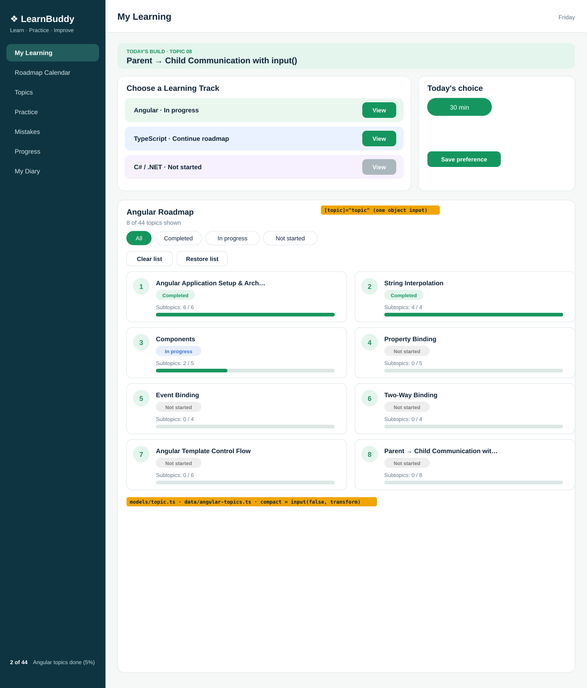

# Topic 08 Parent → Child Communication with input(): Day 14 UI breakdown

## What is new today
- A `Topic` type (`models/topic.ts`) and the data in its own file (`data/angular-topics.ts`), typed as `Topic[]`.
- `TopicCard` takes one object input `topic` (instead of `no`, `title`, `status`), shows `Subtopics: done / total` and a green progress bar, and has a `compact` flag.
- `TopicCatalog` binds one value: `<app-topic-card [topic]="topic" />`.

## Components and files

| Component / file | Owns (what it shows) | Data (exact values) | File |
|---|---|---|---|
| `App`, `Sidebar`, `Header`, `MyLearning`, `TrackCards`, `TodayChoice` | Unchanged | unchanged | as on Day 13 |
| `TodayBuild` | Mint banner | `topicNo` `'08'`, `topicTitle` `'Parent → Child Communication with input()'` (unchanged) | `src/app/today-build/today-build.ts` |
| `TopicCatalog` | Card `Angular Roadmap`, subtitle, chips, buttons, grid of cards | `topics: Topic[] = [...ANGULAR_TOPICS]`, `filter: string = 'all'` | `src/app/topic-catalog/topic-catalog.ts`, `.html` |
| `TopicCard` | Number circle, title, badge, subtopics line, progress bar | input `topic` (required `Topic`), input `compact` (default `false`) | `src/app/topic-card/topic-card.ts`, `.html`, `.css` |
| `Topic`, `TopicStatus` (new) | Types only (nothing on screen) | see below | `src/app/models/topic.ts` |
| `ANGULAR_TOPICS` (new location) | The 8 topics | see table below | `src/app/data/angular-topics.ts` |

Types:

| Name | Definition |
|---|---|
| `TopicStatus` | `'done' \| 'in-progress' \| 'not-started'` |
| `Topic` | `no: number; title: string; status: TopicStatus; subtopicsDone: number; subtopicsTotal: number;` |

Data (`ANGULAR_TOPICS: Topic[]`) and what each card shows:

| no | title | status | subtopicsDone | subtopicsTotal | Line shown | Bar fill |
|---|---|---|---|---|---|---|
| 1 | Angular Application Setup & Architecture | done | 6 | 6 | `Subtopics: 6 / 6` | 100% |
| 2 | String Interpolation | done | 4 | 4 | `Subtopics: 4 / 4` | 100% |
| 3 | Components | in-progress | 2 | 5 | `Subtopics: 2 / 5` | 40% |
| 4 | Property Binding | not-started | 0 | 5 | `Subtopics: 0 / 5` | 0% |
| 5 | Event Binding | not-started | 0 | 4 | `Subtopics: 0 / 4` | 0% |
| 6 | Two-Way Binding | not-started | 0 | 4 | `Subtopics: 0 / 4` | 0% |
| 7 | Angular Template Control Flow | not-started | 0 | 6 | `Subtopics: 0 / 6` | 0% |
| 8 | Parent → Child Communication with input() | not-started | 0 | 8 | `Subtopics: 0 / 8` | 0% |

Badge text: `done` shows `Completed`, `in-progress` shows `In progress`, `not-started` shows `Not started`.

## HTML elements used (new today)

| Element | What it does on screen |
|---|---|
| `<small>` | Grey line `Subtopics: 2 / 5` under the badge |
| `
` with `aria-label` | Grey track of the progress bar |
| `
` | Green fill; its width is the percent |
| `class="topic-card"` plus `compact` | The card gets the class `compact` when the flag is on |

## CSS used (exact values)

`topic-card.css`: the seven rules from Day 13 (unchanged) plus

| Rule | Declarations | Effect |
|---|---|---|
| `.body small` | `display: block; margin-top: 8px; color: var(--muted); font-size: 12px;` | Small grey line on its own line |
| `.bar` | `height: 8px; margin-top: 6px; background: #dde7e5; border-radius: 4px; overflow: hidden;` | Grey rounded track |
| `.bar-fill` | `height: 100%; background: var(--green);` | Green fill as tall as the track |
| `.compact` | `padding: 8px 12px;` | Smaller card; must stay at the end of the file |

`topic-catalog.css`: unchanged from Day 13.

**Unchanged from yesterday:** all components except `TopicCard` and `TopicCatalog`, `topic-catalog.css`, the sub line, chips, buttons, `.cards` grid, `styles.css`.
