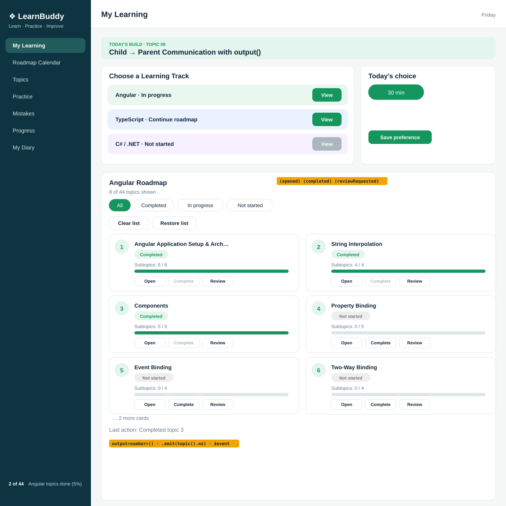

# Topic 09 Child → Parent Communication with output(): Day 15 UI breakdown

## What is new today
- `TopicCard`: each card has three small buttons `Open`, `Complete`, `Review`. Each button sends an event (an `output`) with the topic number.
- `TopicCatalog`: listens to the three events, changes the topic data on `Complete`, and shows `Last action: ...` under the cards.

## Components

| Component | Owns (what it shows) | Data (exact values) | File |
|---|---|---|---|
| `App` | Page shell | none | `src/app/app.html` |
| `Sidebar` | Left column, 7 links, footer | `2 of 44 Angular topics done (5%)` | `src/app/sidebar/sidebar.html` |
| `Header` | Title and weekday | `My Learning`, weekday of today | `src/app/header/header.html` |
| `MyLearning` | Banner, two columns, catalog | none | `src/app/my-learning/my-learning.html` |
| `TodayBuild` | Mint banner | `topicNo` `'09'`, `topicTitle` `'Child → Parent Communication with output()'` | `src/app/today-build/today-build.ts` |
| `TrackCards` | Track list card | unchanged | `src/app/track-cards/track-cards.html` |
| `TodayChoice` | Choice card | unchanged | `src/app/today-choice/today-choice.html` |
| `TopicCatalog` | Card `Angular Roadmap`, filters, 8 cards, last action | `filter` `'all'`, `lastAction` `'Nothing yet'` | `src/app/topic-catalog/topic-catalog.html` |
| `TopicCard` | One topic: number, title, badge, subtopics, bar, 3 buttons | input `topic`, outputs `opened`, `completed`, `reviewRequested` | `src/app/topic-card/topic-card.html` |

Outputs of `TopicCard` (each carries the topic number, type `number`):

| Output | Sent by button | Parent handler in `TopicCatalog` | Sets `lastAction` to |
|---|---|---|---|
| `opened` | `Open` | `onOpen($event)` | `Opened topic 3` (for topic 3) |
| `completed` | `Complete` | `onComplete($event)` | `Completed topic 3`; also status `done` and `subtopicsDone` = `subtopicsTotal` |
| `reviewRequested` | `Review` | `onReview($event)` | `Review requested for topic 3` |

Starting data (`ANGULAR_TOPICS`, unchanged from Day 14): topics 1-2 `done` (6/6, 4/4), topic 3 `in-progress` (2/5), topics 4-8 `not-started` (0/5, 0/4, 0/4, 0/6, 0/8). `Complete` is disabled on topics 1 and 2 at the start.

## HTML elements used (new today)

| Element | What it does on screen |
|---|---|
| `
` (inside the card's `.body`) | Holds the three small buttons under the progress bar |
| `<button (click)="opened.emit(topic().no)">Open</button>` | Sends `opened` with the topic number |
| `<button (click)="completed.emit(topic().no)" [disabled]="topic().status === 'done'">Complete</button>` | Sends `completed`; disabled for finished topics |
| `<button (click)="reviewRequested.emit(topic().no)">Review</button>` | Sends `reviewRequested` |
| `
` (in the catalog) | Grey line `Last action: Nothing yet` under the cards |

## CSS used (exact values)

`topic-card.css` (new rules, added at the end)

| Rule | Declarations | Effect |
|---|---|---|
| `.actions` | `display: flex; flex-wrap: wrap; gap: 6px; margin-top: 10px;` | Buttons in a row, wrap if narrow |
| `.actions button` | `background: white; color: var(--ink); border: 1px solid var(--line); border-radius: 8px; padding: 5px 10px; font-size: 12px; font-weight: bold; cursor: pointer;` | Small white outlined buttons |
| `.actions button:disabled` | `color: #aab7bd; cursor: not-allowed;` | Light grey text, "not allowed" pointer |

`topic-catalog.css` (new rule, added at the end)

| Rule | Declarations | Effect |
|---|---|---|
| `.last-action` | `margin: 12px 0 0; color: var(--muted); font-size: 14px;` | Grey status line under the cards |

The card's `.actions` and the catalog's `.actions` are different rules in different files; scoped CSS keeps them apart.

**Unchanged from yesterday:** `App`, `Sidebar`, `Header`, `MyLearning` (files, text, CSS), `TrackCards`, `TodayChoice`, `styles.css`, `models/topic.ts`, `data/angular-topics.ts`, `topic-card.css` existing rules, and the rest of `topic-catalog.css`.
