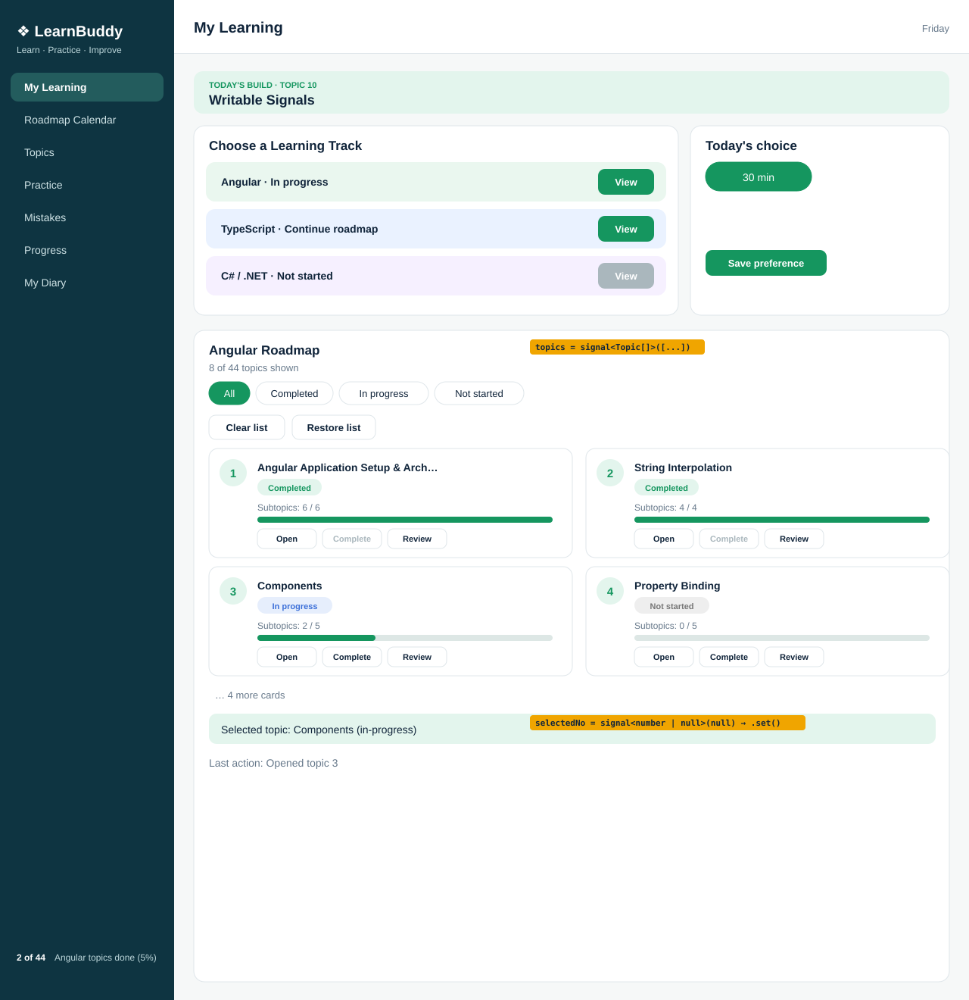

# Topic 10 Writable Signals: Day 16 UI breakdown

## What is new today
- `TopicCatalog`: its data lives in signals (`topics`, `filter`, `selectedNo`, `lastAction`).
- A mint panel `Selected topic: ...` under the cards. `Open` on a card fills it; before any click it says `none`.

## Components

| Component | Owns (what it shows) | Data (exact values) | File |
|---|---|---|---|
| `App` | Page shell | none | `src/app/app.html` |
| `Sidebar` | Left column, 7 links, footer | `2 of 44 Angular topics done (5%)` | `src/app/sidebar/sidebar.html` |
| `Header` | Title and weekday | `My Learning`, weekday of today | `src/app/header/header.html` |
| `MyLearning` | Banner, two columns, catalog | none | `src/app/my-learning/my-learning.html` |
| `TodayBuild` | Mint banner | `topicNo` `'10'`, `topicTitle` `'Writable Signals'` | `src/app/today-build/today-build.ts` |
| `TrackCards` | Track list card | unchanged | `src/app/track-cards/track-cards.html` |
| `TodayChoice` | Choice card | unchanged | `src/app/today-choice/today-choice.html` |
| `TopicCatalog` | Roadmap card, filters, 8 cards, selected panel, last action | signals below | `src/app/topic-catalog/topic-catalog.html` |
| `TopicCard` | One topic with 3 buttons | unchanged from Day 15 | `src/app/topic-card/topic-card.html` |

Signals in `TopicCatalog`:

| Signal | Type | Starting value | Changed by |
|---|---|---|---|
| `topics` | `signal<Topic[]>` | copy of `ANGULAR_TOPICS` (8 topics) | `onComplete`, `clear`, `restore` |
| `filter` | `signal<string>` | `'all'` | `setFilter` |
| `selectedNo` | `signal<number \| null>` | `null` | `onOpen` |
| `lastAction` | `signal<string>` | `'Nothing yet'` | `onOpen`, `onComplete`, `onReview` |

Method `selectedTopic(): Topic | undefined` returns the topic whose `no` equals `selectedNo()`, or `undefined`.

Panel texts: no selection: `Selected topic: none. Click Open on a card.` After `Open` on topic 3: `Selected topic: Components (in-progress)` with `Components` in bold. After `Complete` on topic 3: `Selected topic: Components (done)`.

## HTML elements used (new today)

| Element | What it does on screen |
|---|---|
| `
` with text and `<strong>{{ chosen.title }}</strong>` | Mint panel with the topic title in bold |
| `
` in `@else` | Mint panel with the `none` message |

Everything else (chips, `.actions`, `.cards`, `<app-topic-card>`, `
`) is unchanged in markup; only the signal reads got `()`.

## CSS used (exact values)

`topic-catalog.css` (new rule, added at the end)

| Rule | Declarations | Effect |
|---|---|---|
| `.selected` | `margin-top: 12px; padding: 10px 14px; background: var(--mint); border-radius: 10px; font-size: 14px;` | Mint rounded panel under the cards |

`TrackCards` has its own `.selected` rule (green outline); scoped CSS keeps them apart.

**Unchanged from yesterday:** `App`, `Sidebar`, `Header`, `MyLearning`, `TrackCards`, `TodayChoice`, `TopicCard` (all files), `styles.css`, `models/topic.ts`, `data/angular-topics.ts`, and the rest of `topic-catalog.css`.
