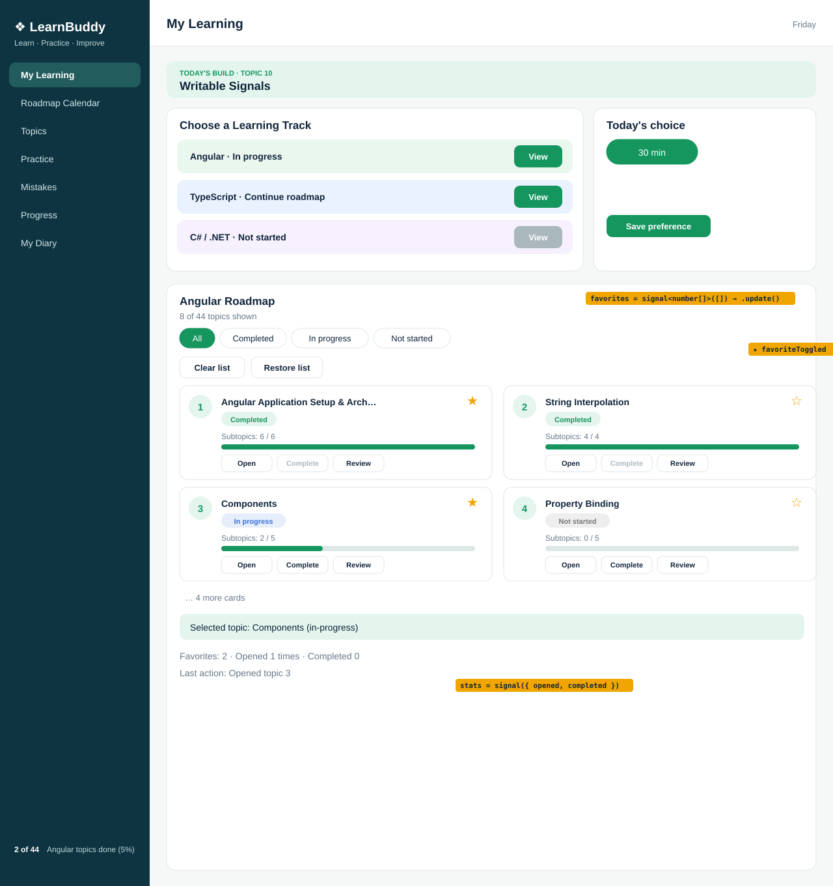

# Topic 10 Writable Signals: Day 17 UI breakdown

## What is new today
- `TopicCard` has a star button (☆ or ★) on every card, a new input `favorite` and a new output `favoriteToggled`.
- `TopicCatalog` keeps two new signals: `favorites` (list of topic numbers) and `stats` (opened and completed counters), and shows them in a new line `Favorites: ...`.
- `onOpen` and `onComplete` now use `.update()`.

## Components

| Component | Owns (what it shows) | Data (exact values) | File |
|---|---|---|---|
| `App` | Page shell | none | `src/app/app.html` |
| `Sidebar` | Left column, 7 links, footer | `2 of 44 Angular topics done (5%)` | `src/app/sidebar/sidebar.html` |
| `Header` | Title and weekday | `My Learning`, weekday of today | `src/app/header/header.html` |
| `MyLearning` | Banner, two columns, catalog | none | `src/app/my-learning/my-learning.html` |
| `TodayBuild` | Mint banner | `topicNo` `'10'`, `topicTitle` `'Writable Signals'` (unchanged) | `src/app/today-build/today-build.ts` |
| `TrackCards` | Track list card | unchanged | `src/app/track-cards/track-cards.html` |
| `TodayChoice` | Choice card | unchanged | `src/app/today-choice/today-choice.html` |
| `TopicCatalog` (changed) | Roadmap card, filters, cards, selected box, two lines of text | `favorites = signal<number[]>([])`, `stats = signal({ opened: 0, completed: 0 })` | `src/app/topic-catalog/topic-catalog.ts`, `.html` |
| `TopicCard` (changed) | One card with star, badge, progress, three action buttons | inputs `topic`, `compact`, `favorite` (default `false`); outputs `opened`, `completed`, `reviewRequested`, `favoriteToggled` | `src/app/topic-card/topic-card.ts`, `.html`, `.css` |

Texts shown at the bottom of the roadmap card at the start:
- `Favorites: 0 · Opened 0 times · Completed 0`
- `Last action: Nothing yet`

After you star topics 1 and 3, open topic 3 once and complete it: `Favorites: 2 · Opened 1 times · Completed 1`, and `Last action: Completed topic 3`.

## HTML elements used (new today)

| Element | What it does on screen |
|---|---|
| `<button class="star">` | The star. Shows `☆` when not a favorite, `★` when it is |
| `aria-label` (bound with `[attr.aria-label]`) | Not visible. Screen reader name: `Add to favorites` or `Remove from favorites` |
| `
` (second one) | The line `Favorites: ... · Opened ... times · Completed ...` |

The star is placed inside `
`, right after `<strong>` (the title).

## CSS used (exact values)

`topic-card.css` (one new rule at the end)

| Rule | Declarations | Effect |
|---|---|---|
| `.star` | `float: right; background: none; border: 0; font-size: 18px; color: #f0a500; cursor: pointer;` | Amber star on the right of the card body, no button box, hand cursor |

`topic-catalog.css`: no change today. The new `Favorites:` line uses the existing `.last-action` rule (`margin: 12px 0 0; color: var(--muted); font-size: 14px;`).

**Unchanged from yesterday:** `App`, `Sidebar`, `Header`, `MyLearning`, `TodayBuild`, `TrackCards`, `TodayChoice`, `models/topic.ts`, `data/angular-topics.ts`, `styles.css`, `topic-catalog.css`, the other rules of `topic-card.css`.
